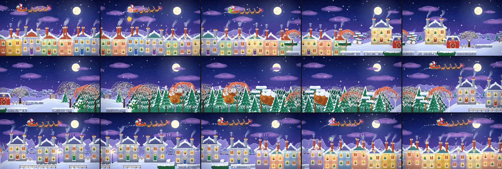

# Mac Scottish Christmas Screensaver

A Christmas screensaver for the Mac, drawn in the style of a children's animation.

The camera stays still while the world glides past, as if you were flying across the United Kingdom at rooftop and treetop height on a snowy night:

- **English terraces**: pastel houses under deep snow, with chimney stacks, TV aerials, long icicles, fairy lights, and little Christmas trees glowing in the windows.
- **Snowy countryside**: a stone farmhouse, a red barn, sheep, a frozen pond, a snowman, drystone walls and fences, all glittering with icicles.
- **A forest canopy**: treetops of Scots pine, spruce, bare oak, silver birch, copper beech, holly and berry-laden rowan.
- **A Scottish stone village**: cottages with big chimney stacks, a Highland castle in the distance, and a moon over the hills.
- **Santa**: whenever you pass rooftops, Santa's sleigh and reindeer (Rudolph leading) appear and drop presents, wrapped in coloured paper with gold and silver ribbons, down the chimneys in a burst of sparkles.



| Rooftops | Countryside |
|---|---|
|  |  |
| **Forest canopy** | **Scottish village** |
|  |  |

The screensaver plays a pre-drawn film of 3 minutes 44 seconds (two full journeys, each with different houses and trees) in a seamless loop. Each time it starts, and on each display, it begins at a different point. It has no sound, and because the film is played by the Mac's video hardware it uses very little power.

## What you need

- A Mac running **macOS 14 (Sonoma) or later**, Apple Silicon or Intel.

## Install (the easy way): download it

1. Go to the **Releases** page of this repository and download `Scottish-Christmas-Screensaver-1.0.0.zip` (about 140 MB).
2. Double-click the zip to unpack it. You will get a folder containing `Scottish Christmas.saver` and `install.sh`.
3. Open **Terminal** (press Cmd+Space, type `Terminal`, press Return), type `cd ` (with a space after it), drag the unpacked folder onto the Terminal window, and press Return.
4. Run the installer:

   ```
   ./install.sh
   ```

   If macOS says the script is not allowed to run, type `chmod +x install.sh` and press Return, then run it again.

   The installer copies the screensaver to `~/Library/Screen Savers` and removes the "downloaded from the internet" flag, so macOS will not refuse to open it.
5. Open **System Settings > Screen Saver**, scroll to find **Scottish Christmas**, and click it. Choose how long the Mac should wait before it starts, and you are done.

### Installing by hand instead

If you would rather not use Terminal: unzip the download, then open Terminal once and run `xattr -dr com.apple.quarantine "Scottish Christmas.saver"` from the folder that contains it. After that, double-click `Scottish Christmas.saver` and choose **Install for this user only** when System Settings asks.

## Install (the other way): build it yourself

You need the Xcode command-line tools (`xcode-select --install`) and ffmpeg (`brew install ffmpeg`).

```
git clone <this repository>
cd <the folder>
./make_video.sh     # draws the film, about 4 minutes; it uses all your CPU cores while it runs
./build.sh          # builds "build/Scottish Christmas.saver" (Apple Silicon and Intel)
./install.sh        # installs it for you
```

Then open **System Settings > Screen Saver** and choose **Scottish Christmas**.

## Take it off again

```
./uninstall.sh
```

or delete `Scottish Christmas.saver` from `~/Library/Screen Savers` in Finder (in Finder choose Go > Go to Folder and paste `~/Library/Screen Savers`).

## If something is not right

| Problem | What to try |
|---|---|
| It is not listed in System Settings | Run `killall legacyScreenSaver`, then close and reopen System Settings. Check that `~/Library/Screen Savers/Scottish Christmas.saver` exists. |
| macOS says it is damaged, or cannot verify the developer | Run `xattr -dr com.apple.quarantine "$HOME/Library/Screen Savers/Scottish Christmas.saver"`, then try again. The screensaver is signed only with a local ad-hoc signature, because it is not distributed through Apple. |
| Black screen, or a message that the film is missing | The film must be inside the saver. Check with `ls "$HOME/Library/Screen Savers/Scottish Christmas.saver/Contents/Resources"`. It should list `christmas-flight.mp4`. If not, reinstall. |
| The picture is cropped on an ultra-wide display | On displays wider than about 2:1 the whole picture is shown with black bars so Santa and the rooftops are never cut off. On other displays the picture fills the screen and trims a little from the sides on 16:10 screens. |

## How it is made

The artwork is drawn entirely in code (Swift and Core Graphics), with no image files. The scene is a pure function of time, so the same drawing code produces every frame of the film.

| Part | What it does |
|---|---|
| `Sources/Support.swift` | Drawing helpers: snow, icicles, glitter, glows |
| `Sources/Nature.swift` | UK trees, sheep, snowman, fences, walls, hedges, pond |
| `Sources/Buildings.swift` | Houses, chimneys, aerials, windows, lights, church, barn |
| `Sources/Santa.swift` | Santa, sleigh, reindeer, presents, magic dust |
| `Sources/ChristmasScene.swift` | The world, the layers, snowfall, Santa's flight and present timing |
| `Tools/main.swift` | The renderer: draws single frames or the whole film |
| `Saver/ChristmasFlightView.swift` | The screensaver: plays the film silently, in a loop |

Useful commands:

```
./build_tool.sh                           # builds the renderer (build/render)
./build/render still 10 frame.png         # one picture, 10 seconds into the journey
./build/render video film.mp4 90 30       # a 90-second preview film (1080p, 30 fps)
```

To change how long the film is, change the number of seconds passed to `render video` in `make_video.sh` (one full journey is 112 seconds, and the world makes new houses and trees for each journey).

Presents, houses and trees are all generated from fixed random seeds, so the film is the same every time it is rendered.

## Licence and credits

Drawn and generated with Claude. No licence has been chosen yet, so all rights are reserved until one is added.
