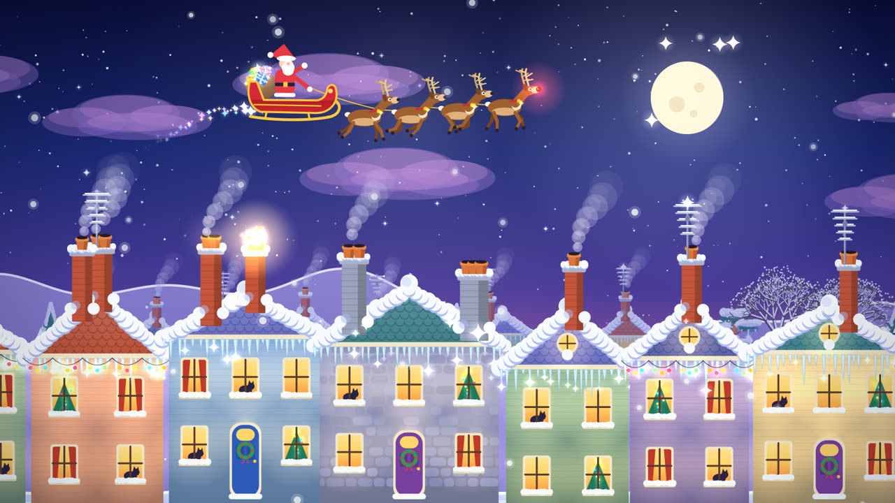
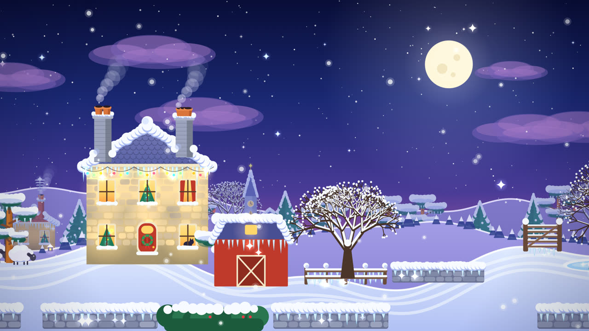
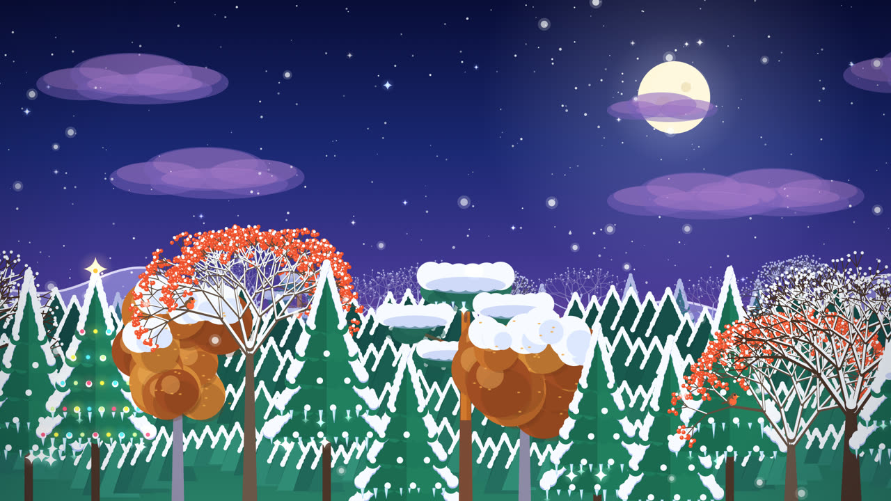
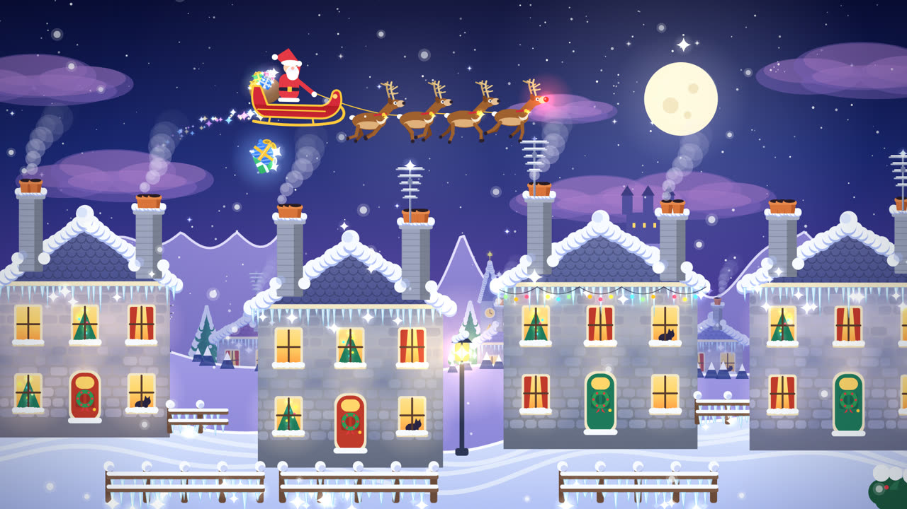

# Mac Scottish Christmas Screensaver

A Christmas screensaver for the Mac, drawn in the style of a children's animation.

The camera stays still while the world glides past, as if you were flying across the United Kingdom at rooftop and treetop height on a snowy night:

- **English terraces**: pastel houses under deep snow, with chimney stacks, TV aerials, long icicles, fairy lights, and little Christmas trees glowing in the windows.
- **Snowy countryside**: a stone farmhouse, a red barn, sheep, a frozen pond, a snowman, drystone walls and fences, all glittering with icicles.
- **A forest canopy**: treetops of Scots pine, spruce, bare oak, silver birch, copper beech, holly and berry-laden rowan.
- **A Scottish stone village**: cottages with big chimney stacks, a Highland castle in the distance, and a moon over the hills.
- **Santa**: whenever you pass rooftops, Santa's sleigh and reindeer (Rudolph leading) appear and drop presents, wrapped in coloured paper with gold and silver ribbons, down the chimneys in a burst of sparkles.


| Rooftops | Countryside |
|---|---|
|  |  |
| **Forest canopy** | **Scottish village** |
|  |  |

## Two versions

| | **Live** (`Scottish Christmas Live`) | **Film** (`Scottish Christmas`) |
|---|---|---|
| How it works | Drawn live as it plays, and never ends: every journey makes new houses and trees | Plays a pre-drawn 3 min 44 s film in a loop |
| Look | Identical artwork, sharp at any screen size | Identical artwork, 1080p |
| Power | About 30 to 50% of one processor core, about 170 MB of memory | Very little (the Mac's video hardware plays it) |
| Size | A few hundred KB | About 140 MB |
| Start | A different place in the endless journey each time | A different point in the film each time |

If one misbehaves on your Mac, try the other. They can be installed side by side.

## What you need

- A Mac running **macOS 14 (Sonoma) or later**, Apple Silicon or Intel.

## Install the Live version

### The easy way: download it

1. Go to the **Releases** page of this repository and download `Scottish-Christmas-Live-Screensaver-2.0.0.zip` (a few hundred KB).
2. Double-click the zip to unpack it. You will get a folder containing `Scottish Christmas Live.saver` and `install.sh`.
3. Open **Terminal** (press Cmd+Space, type `Terminal`, press Return), type `cd ` (with a space after it), drag the unpacked folder onto the Terminal window, and press Return.
4. Run the installer:

   ```
   ./install.sh live
   ```

   If macOS says the script is not allowed to run, type `chmod +x install.sh` and press Return, then run it again.
5. Open **System Settings > Screen Saver**, scroll to **Scottish Christmas Live**, and click it. Choose how long the Mac should wait before it starts, and you are done.

### Or build it yourself

It takes a few seconds, and no film is needed. You need the Xcode command-line tools: type `xcode-select --install` in Terminal if you do not have them.

```
git clone <this repository>
cd <the folder>
./build_live.sh     # builds "build/Scottish Christmas Live.saver" (Apple Silicon and Intel)
./install.sh live   # installs it for you
```

## Install the Film version

### The easy way: download it

1. Go to the **Releases** page of this repository and download `Scottish-Christmas-Screensaver-1.0.0.zip` (about 140 MB).
2. Double-click the zip to unpack it. You will get a folder containing `Scottish Christmas.saver` and `install.sh`.
3. Open **Terminal** (press Cmd+Space, type `Terminal`, press Return), type `cd ` (with a space after it), drag the unpacked folder onto the Terminal window, and press Return.
4. Run the installer:

   ```
   ./install.sh
   ```

   If macOS says the script is not allowed to run, type `chmod +x install.sh` and press Return, then run it again.

   The installer copies the screensaver to `~/Library/Screen Savers` and removes the "downloaded from the internet" flag, so macOS will not refuse to open it.
5. Open **System Settings > Screen Saver**, scroll to find **Scottish Christmas**, and click it.

If you would rather not use Terminal: unpack the download, run `xattr -dr com.apple.quarantine "Scottish Christmas.saver"` once from the folder that contains it, then double-click `Scottish Christmas.saver` and choose **Install for this user only**.

### Or build it yourself

You need the Xcode command-line tools and ffmpeg (`brew install ffmpeg`).

```
./make_video.sh     # draws the film, about 4 minutes; it uses all your CPU cores while it runs
./build.sh          # builds "build/Scottish Christmas.saver" (Apple Silicon and Intel)
./install.sh        # installs it for you
```

## Take it off again

```
./uninstall.sh          # the film version
./uninstall.sh live     # the live version
```

or delete the `.saver` from `~/Library/Screen Savers` in Finder (choose Go > Go to Folder and paste `~/Library/Screen Savers`).

## If something is not right

| Problem | What to try |
|---|---|
| It is not listed in System Settings | Run `killall legacyScreenSaver`, then close and reopen System Settings. Check that the `.saver` exists in `~/Library/Screen Savers`. |
| macOS says it is damaged, or cannot verify the developer | Run `xattr -dr com.apple.quarantine "$HOME/Library/Screen Savers/Scottish Christmas Live.saver"` (or `Scottish Christmas.saver` for the film version), then try again. The screensaver is signed only with a local ad-hoc signature, because it is not distributed through Apple. |
| Black screen (film version), or a message that the film is missing | The film must be inside the saver. Check with `ls "$HOME/Library/Screen Savers/Scottish Christmas.saver/Contents/Resources"`. It should list `christmas-flight.mp4`. If not, reinstall. |
| The picture is cropped on an ultra-wide display (film version) | On displays wider than about 2:1 the whole picture is shown with black bars so Santa and the rooftops are never cut off. The live version simply draws a wider picture. |
| Choppy motion (live version) | Close other heavy apps and try again, or use the film version, which asks almost nothing of the Mac. |

## How it is made

The artwork is drawn entirely in code (Swift and Core Graphics), with no image files. The scene is a pure function of time: the same drawing code makes the film and runs the live version.

| Part | What it does |
|---|---|
| `Sources/Support.swift` | Drawing helpers: snow, icicles, glitter, glows, and the "baking" support described below |
| `Sources/Nature.swift` | UK trees, sheep, snowman, fences, walls, hedges, pond |
| `Sources/Buildings.swift` | Houses, chimneys, aerials, windows, lights, church, barn |
| `Sources/Santa.swift` | Santa, sleigh, reindeer, presents, magic dust |
| `Sources/ChristmasScene.swift` | The world (built from a seed for each journey, so it can go on for ever), the layers, snowfall, Santa's flight and present timing |
| `Tools/main.swift` | The film renderer: draws single frames or the whole film |
| `Saver/ChristmasFlightView.swift` | The film version of the screensaver: plays the film silently, in a loop |
| `Live/LiveEngine.swift` | The live engine: cached scenery tiles, per-frame overlays, and the Core Animation layers |
| `Live/FramePipeline.swift` | Draws frames ahead on two background threads and hands each to the screen on time |
| `Live/LiveView.swift` | The live version of the screensaver |

**How the live version stays fast.** Drawing everything every frame takes about 100 ms on one processor core, far too slow for smooth motion. But the houses, trees and snowy ground only ever slide sideways, so they are drawn once into cached "tiles" on a background thread, a little ahead of the camera. Each frame then draws only what actually moves (falling snow, smoke, twinkling lights, Santa, the presents) into two transparent pictures, which take 3 to 14 ms. The graphics chip stacks tiles and pictures and scrolls the distant hills at their own slower speeds. Frames are timed by the display's own refresh signal so the glide stays even.

Useful commands:

```
./build_tool.sh                              # builds the film renderer (build/render)
./build/render still 10 frame.png            # one picture, 10 seconds into the journey
./build/render video film.mp4 90 30          # a 90-second film (1080p, 30 fps)
./build_livetest.sh                          # builds a test tool for the live engine (build/livetest)
./build/livetest still 10 frame.png          # one frame, composited exactly as the live saver does
./build/livetest bench                       # times the scenery caching and each live frame
./package.sh live 2.0.0                      # makes the download zip in dist/
```

Everything is generated from fixed random seeds, so the same journey always looks the same.

## Licence and credits

Released under the [MIT Licence](LICENSE): you are free to use, change and share it, including the artwork and code, as long as the licence notice stays with it.

Drawn and generated with Claude.
